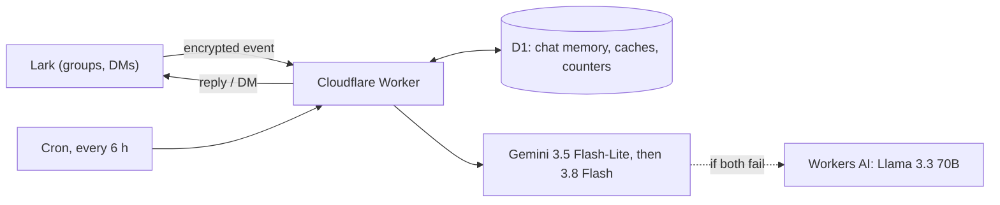

# Eleyna: an AI secretary for Lark

Eleyna is the AI secretary of **AI Exploration**, a department of the AI Builders Club at Sunway University. She lives inside the club's Lark workspace: she answers questions in every group chat, knows the club wiki, welcomes new members by DM and keeps event groups organised.

She runs 24/7 on **Cloudflare Workers' free plan** with **Gemini's free tier**, so she costs nothing and needs no laptop left on.

<!-- Screenshot: add docs/demo.png (Eleyna answering in a group) and uncomment the line below. -->
<!--  -->

## What she does

- **Every group gets its own assistant.** Mention `@Eleyna` and she answers from *that group only*: its description, pinned messages, calendar events, the pages they link to and the recent chat. One group never sees another.
- **DMs know the whole club.** She searches one index of every calendar event, the wiki, the groups and their pinned notes, so "anything on Thursday?" or "Qwen conference timeline?" is answered from the source, with the event's own page read for details.
- **Join from a DM.** Everyone may know every event, but a group's chat is for its members. Ask about a group you're not in and she says it exists, shares the event's details and offers to add you: tap **Join** (or reply *yes*) and she adds you and DMs you its details. `/clear` forgets your DM history.
- **Research by reading.** For "who are the speakers, should I go?" she opens more of the event's official site (agenda, speakers) and gives a short verdict.
- **Onboarding.** Anyone added to the team group gets a welcome DM from her first: what the club is, what to read, Lark tips and questions to try.
- **Event groups.** She adds people who accept an event's invite to its group, and posts a one-time "💡 Good to know" note (parking, entrance, food, what to bring) and a "🔔 Tomorrow" reminder.
- **Stays in her lane.** Homework, essays or code? She declines with a rotating, swear-free roast and points you to the right tool.
- **Watches her own budget.** `@Eleyna usage` reports this month's Lark API calls and AI tokens, and she warns the owner at 75% and 90% of Lark's free quota.

## How it works

1. Lark sends each message to `POST /lark/events`. The Worker checks the verification token and signature, decrypts the body (AES-256-CBC) and drops duplicate deliveries.
2. Every group message is saved to D1, which costs no Lark API call. Only a message that mentions Eleyna, or a DM, gets an answer.
3. To answer, she builds a small context for that one chat, asks Gemini and replies to the message.
4. Every 6 hours a cron adds people who accepted events, posts the briefings and checks the quota.

## Built for free tiers

The interesting part is fitting a useful bot inside limits that are easy to hit:

| Limit | What the code does |
|---|---|
| **30 s of background time** per Lark event (Cloudflare free) | Every answer has one 25 s budget. Page fetches have timeouts and run in parallel, the fast model goes first with minimal thinking, and the backup model takes over if time runs short. Typical answer: 1–8 s. |
| **About 10,000 Lark API calls a month** for the whole workspace | The token, chat info, pins, members and calendar are cached in D1. Chat history comes from saved messages, not the API. The cron runs every 6 h and skips finished events. Every call is counted. |
| **Free-tier model quotas, and models that get retired** | Models are tried in the order listed in `wrangler.toml`, so switching needs no code change. Cloudflare's own Workers AI is the last resort. |
| **Token cost** | Pages and chat are trimmed to the lines relevant to the question. The prompt marks the one message to answer, so the model doesn't re-answer old chat. |
| **The model never sees its own past replies** | Roast endings and jabs are picked in code, with weights, and skip the last two used in that chat, so refusals don't repeat. |

Nothing can be billed: neither Cloudflare nor Google has a card on file, and free plans stop rather than charge.

## Security

- The webhook **fails closed**: without a valid verification token there's no answer, and once an Encrypt Key is set, unencrypted bodies are rejected.
- All keys are Cloudflare secrets (`LARK_APP_SECRET`, `LARK_ENCRYPT_KEY`, `LARK_VERIFICATION_TOKEN`, `GEMINI_API_KEY`, `DEBUG_KEY`), never in the repo.
- Test routes (`/debug/*`) answer only with the `x-debug-key` header and return 404 otherwise.
- Eleyna reads only what the bot has been given: the groups she's in, the club wiki and public pages linked in those groups.

## Project layout

| File | What it does |
|---|---|
| `src/index.js` | The webhook, the locked test routes and the cron entry point |
| `src/handlers.js` | Group messages, DMs and deciding when to answer |
| `src/context.js` | Builds one chat's context: description, pins, events, linked pages, recent chat |
| `src/knowledge.js` | Lists the club wiki's pages; the fallback when search finds nothing |
| `src/search.js` | The search index (D1 full-text, BM25): events, wiki, groups, pins, group chat; who may see what |
| `src/join.js` | Join offers, adding someone to a group, the Join card and the details sent after |
| `src/brain.js` | Gemini in order, then Workers AI, inside the time budget |
| `src/prompts.js` | What she's told: scope, rules, research mode, DMs, briefings |
| `src/roast.js` | Rotating out-of-scope endings and jabs |
| `src/handbook.js` | What she says about the club, and the welcome DM (owner-only) |
| `src/onboard.js` | Sends the welcome once per person; a failed send stays retryable |
| `src/usage.js` | The usage report and the 75% and 90% alerts |
| `src/cron.js` | Refreshes the search index, auto-join and briefings |
| `src/lark.js`, `src/crypto.js`, `src/store.js`, `src/text.js` | The Lark API (with caching and call counting), webhook crypto, D1 storage and text helpers |
| `schema.sql` | D1 tables |
| `test/bot.test.js` | Offline tests (`npm test`): no network, no keys |
| `docs/ROADMAP.md` | Her jobs, what's next and the Lark settings she depends on |

**Stack:** JavaScript (ES modules), Cloudflare Workers, D1 (SQLite), Workers AI, the Gemini API and the Lark Open Platform. No runtime dependencies; Wrangler for deploys.

## Run your own

**The easy way: let an AI set it up.** Clone the repo, open it in an AI coding agent (Claude Code, Codex, Cursor…) and say *"set this bot up for my Lark"*. The agent follows [`AGENTS.md`](AGENTS.md):
- it asks for your bot's name, organisation and welcome message, and rewrites the handbook;
- it runs every command and tells you exactly where to click in Lark;
- it checks each step before moving on.

You never paste a secret into the chat: the agent gives you `npx wrangler secret put` commands to run in your own terminal.

**By hand:** you need a Lark custom app with a bot, a Cloudflare account and a Gemini API key (from aistudio.google.com).

1. Run `npm install`, then `npx wrangler login`.
2. Run `npx wrangler d1 create lark-event-bot`, put the `database_id` in `wrangler.toml`, then run `npx wrangler d1 execute lark-event-bot --remote --file schema.sql`.
3. In `wrangler.toml`, set:
   - `LARK_APP_ID`;
   - `ONBOARDING_CHAT_ID`, the group whose new members get the welcome;
   - `ALERT_CHAT_ID`, where quota warnings go.
4. Run `npx wrangler deploy` and note the URL, `https://lark-event-bot.<you>.workers.dev`.
5. Set each secret with `npx wrangler secret put <NAME>`: `LARK_APP_SECRET`, `GEMINI_API_KEY`, `LARK_ENCRYPT_KEY`, `LARK_VERIFICATION_TOKEN` and `DEBUG_KEY` (any long random string).
6. In the Lark developer console, open your app:
   - **Events & Callbacks:**
     - set the request URL to `https://lark-event-bot.<you>.workers.dev/lark/events`;
     - copy the Encrypt Key and Verification Token into the secrets;
     - add the events *Message received*, *User added to group* and *User enters chat with bot*;
     - **Callback configuration:** send callbacks to the same URL and add *card.action.trigger* (the Join button), then set `JOIN_BUTTON = "on"` in `wrangler.toml`.
   - **Availability:** include everyone she should talk to, or Lark refuses with `230013`.
   - Create and publish a version.
7. Fill the search index once: `curl -s -X POST https://lark-event-bot.<you>.workers.dev/debug/reindex -H "x-debug-key: <DEBUG_KEY>"` (run it again while it reports wiki pages `left`; the cron keeps it fresh after that).
8. In any group with the bot, write `@Eleyna what can you do?`

Logs: `npx wrangler tail`. Tests: `npm test`.

## Gotchas

- `/bot/v3/info` returns `bot` at the top level, not under `data`. Reading it wrong makes every mention look unaddressed.
- In events, a mention's id is an object, `{open_id}`; the message API returns it as a plain string.
- With a wrong `LARK_ENCRYPT_KEY`, the logs show "Decryption failed" and she goes silent.
- Publishing a new app version doesn't change who can use the app. Check **Availability** in the version itself.
- Providers retire models often. If answers stop, check `npx wrangler tail` and change the model names in `wrangler.toml`.

## Licence

This repository is public so people can read how it works. No licence is granted, so all rights are reserved: please ask before reusing the code.
