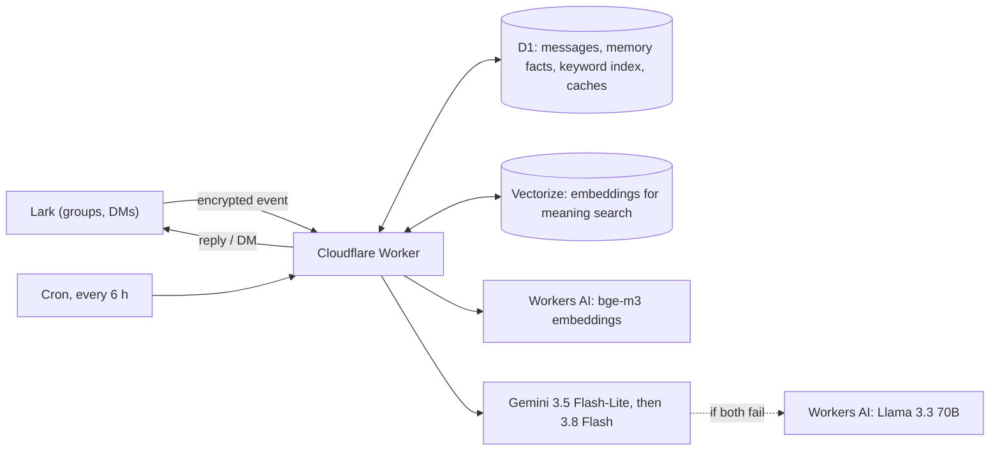

# Eleyna: an AI secretary for Lark

Eleyna is the AI secretary of **AI Exploration**, a department of the AI Builders Club at Sunway University. She lives inside the club's Lark workspace: she answers questions in every group chat, knows the club wiki, welcomes new members by DM and keeps event groups organised.

She runs 24/7 on **Cloudflare Workers' free plan** with **Gemini's free tier**, so she costs nothing and needs no laptop left on.

<!-- Screenshot: add docs/demo.png (Eleyna answering in a group) and uncomment the line below. -->
<!--  -->

## What she does

- **Every group gets its own assistant.** Mention `@Eleyna` and she answers from *that group only*: its description, pinned messages, calendar events, the pages they link to and the recent chat. One group never sees another.
- **Each group gets its own wiki.** `GROUP_WIKIS` in `wrangler.toml` gives a group its wiki space(s): the PR Exploration group sees only the PR Exploration wiki, the AI Exploration team group only the AI Exploration wiki. A group not listed sees no wiki.
- **DMs are limited by team.** Everyone gets the wikis in `OPEN_WIKIS`; a team's private wiki only reaches people in one of its groups (`GROUP_WIKIS`); the owner sees everything.
- **She reads team trackers.** A Base in a wiki (the PR Tracker) is read like a page, one line per row, re-read every 12 hours, with the same per-chat limits. So "who's posting Friday?" or "what are my tasks this week?" works.
- **DMs know the whole club.** She searches one index of every calendar event, the wiki, the groups and their pinned notes, so "anything on Thursday?" or "Qwen conference timeline?" is answered from the source, with the event's own page read for details.
- **Join from a DM.** Everyone may know every event, but a group's chat is for its members. Ask about a group you're not in and she says it exists, shares the event's details and offers to add you: tap **Join** (or reply *yes*) and she adds you and DMs you its details. `/clear` forgets your DM history and memory.
- **The owner adds people.** "@Eleyna add kai here" in a group, or "add kai and chelsea to the qwen group" in a DM: names are matched in code to people in her groups (any order, with or without spaces, by first name), she asks you to confirm, or to pick by number when several match, then adds them. Only the owner (`OWNER_OPEN_IDS`) can; she tells anyone else so, and never pretends she can do it herself.
- **Research by reading.** For "who are the speakers, should I go?" she opens more of the event's official site (agenda, speakers) and gives a short verdict.
- **Onboarding.** Anyone added to the team group gets a welcome DM from her first: what the club is, what to read, Lark tips and questions to try.
- **Event groups.** She adds people who accept an event's invite to its group, and posts a one-time "💡 Good to know" note (parking, entrance, food, what to bring) and a "🔔 Tomorrow" reminder.
- **Stays in her lane.** Homework, essays or code? She declines with a rotating, swear-free roast and points you to the right tool.
- **Remembers each chat.** Every chat has its own long-term memory: small facts (decisions, dates, who's doing what) pulled from the conversation and kept up to date, after the method of [Mem0](#memory-learning-from-mem0). `/memory` shows it.
- **Watches her own budget.** `@Eleyna usage` reports this month's Lark API calls and AI tokens, and she warns the owner at 75% and 90% of Lark's free quota.

## How it works

1. Lark sends each message to `POST /lark/events`. The Worker checks the verification token and signature, decrypts the body (AES-256-CBC) and drops duplicate deliveries.
2. Every group message is saved to D1, which costs no Lark API call. Only a message that mentions Eleyna, or a DM, gets an answer.
3. To answer, she builds a small context for that one chat (its memory, the facts and items that match the question, the newest messages), asks Gemini and replies to the message.
4. After every 15 messages in a chat, its memory is updated in the background (see [Memory](#memory-learning-from-mem0)).
5. Every 6 hours a cron refreshes the search index (events, wiki, groups), catches up memory for quiet chats, adds people who accepted events, posts the briefings and checks the quota.

## Memory: learning from Mem0

Eleyna's long-term memory follows the method of **[Mem0](https://github.com/mem0ai/mem0)** ("mem-zero"), an open-source memory layer for AI agents, described in the paper *[Mem0: Building Production-Ready AI Agents with Scalable Long-Term Memory](https://arxiv.org/abs/2504.19413)* (Chhikara, Khant, Aryan, Singh and Yadav, April 2025). We use the method, not the library: Mem0 runs as a Python or TypeScript service with its own vector database, which a free Cloudflare Worker can't host, so the same steps are written in about 200 lines (`src/memory.js`) on D1, Vectorize and Gemini.

### The problem it solves

A chat bot normally "remembers" by re-reading the last N messages on every answer. That has three faults:

- **It forgets.** Message N+1 falls off the end, so a decision made two weeks ago is gone.
- **It gets more expensive.** Raising N means more tokens on every single answer, most of them chit-chat.
- **It can't tell old from new.** If "the demo is Thursday" and later "the demo moved to Friday" are both in the window, the model has to work out which is true, every time.

A single running summary fixes the cost, but not the rest: it has a size limit, so it drops details as the chat grows, and each rewrite can lose or blur facts.

### The method

Mem0 keeps memory as **many small facts** ("16 Nov, EJ: the demo moved to Friday"), not one summary, and maintains them in two phases:

1. **Extract.** New messages go to a language model together with a short summary of the conversation. It pulls out only the facts worth keeping (decisions, dates, who does what, preferences) and ignores greetings and chatter.
2. **Update.** For each new fact, the most similar facts already in memory are found by meaning (vector search). The model then decides, for each one, to **add** it (new), **update** an old fact (it changed), **delete** one (no longer true) or do **nothing** (already known).

Answering is the third step: **retrieve** only the facts that match the question, by similarity, and give the model those.

### Why it works so well

- **Memory never has to shrink.** Facts are stored separately and only the few relevant ones are loaded, so a chat can hold thousands of facts while each answer still costs the same handful of tokens.
- **Contradictions are settled once, when they happen.** Because the update step compares new facts with similar old ones, "moved to Friday" replaces "Thursday" in memory instead of both being shown to the model forever.
- **Noise is filtered on the way in.** Chit-chat never becomes memory, so what's retrieved is dense and useful.
- **Retrieval by meaning.** "Where do I leave my car?" finds the fact about parking even though no word matches.

The paper tested this on LOCOMO, a benchmark of long multi-session conversations. Its abstract reports a **26% relative improvement** over OpenAI's memory (answers graded by an LLM judge), and, compared with putting the whole conversation in the prompt, **91% lower latency** (95th percentile) and **over 90% lower token cost**.

### How Eleyna does it

| Mem0 step | Eleyna (`src/memory.js`) |
|---|---|
| Conversation summary used while extracting | A **chat card** per chat (what it's for, what's going on now), rewritten on each update |
| Extract, then decide add / update / delete / nothing | **One call does both** (Gemini, JSON out): it sees the card, the new messages and the facts they might change, and returns `add`, `update` and `remove` lists. Code accepts only ids that exist and citations of real messages |
| After every message | **After every 15 messages from people**, in the background time left after an answer, so a free AI quota lasts. The 6-hourly cron catches up chats that went quiet |
| Similar memories found by vector search | Found by meaning *and* by keyword, plus the 30 newest |
| Retrieval by vector similarity | **Hybrid search**: keyword (SQLite FTS5, BM25) and meaning (bge-m3 embeddings in Vectorize), merged by reciprocal rank fusion. Names like "Qwen" match by keyword, paraphrases by meaning |

An answer in a group reads: the chat card, the facts that match the question (all of them while there are 12 or fewer), and word for word only the messages memory hasn't taken in yet, at least the last 6 so a follow-up like "that's not what I meant" still has its context.

Safeguards:

- **Raw messages are kept** (a DM's are deleted only by `/clear`). Memory is a layer on top of them. Each fact records which messages it came from, and the prompt tells Eleyna that newer messages win over the summary.
- **The database is the source of truth.** A fact found by meaning search is re-read from D1 before it's shown, so a fact changed or removed since its embedding was written appears as it is now, or not at all. Embeddings that fail to write are retried by the cron.
- **Each chat's memory stays in that chat.** A group's facts are shown only in that group, or in a DM to its members. A DM's facts are shown only in that DM.
- **The memory writer stores nothing sensitive**: no phone numbers, personal emails, passwords or codes, and nothing that only Eleyna herself said.
- **One update, all or nothing.** A batch is claimed with an atomic insert, so two messages arriving together don't both process it; its facts, card and place in the chat are then written in one database batch, so a run cut short leaves nothing half-done. Memory reads messages by the order they were saved, so one arriving a moment late isn't skipped.
- **Failures can't loop.** A batch no model can read is skipped after three tries (its messages stay searchable), so it can't use up the free AI quota. A chat keeps at most 300 facts.
- **You can see and wipe it.** `/memory` shows what she remembers about the chat; `/clear` in a DM forgets the chat and its memory.

Known limit: memory takes what people say at face value. A test question asked "in character" (for example, pretending to be a new member) can become a fact. `/clear` removes it.

## Built for free tiers

The interesting part is fitting a useful bot inside limits that are easy to hit:

| Limit | What the code does |
|---|---|
| **30 s of background time** per Lark event (Cloudflare free) | Every answer has one 25 s budget. Page fetches have timeouts and run in parallel, the fast model goes first with minimal thinking, and the backup model takes over if time runs short. Typical answer: 1–8 s. |
| **About 10,000 Lark API calls a month** for the whole workspace | The token, chat info, pins, members and calendar are cached in D1. Chat history comes from saved messages, not the API. The cron runs every 6 h and skips finished events. Every call is counted. |
| **Free-tier model quotas, and models that get retired** | Models are tried in the order listed in `wrangler.toml`, so switching needs no code change. Cloudflare's own Workers AI is the last resort. |
| **Token cost** | Pages are trimmed to the lines relevant to the question; old chat is replaced by its memory. The prompt marks the one message to answer, so the model doesn't re-answer old chat. |
| **Roasts that repeat** | Roast endings and jabs are picked in code, with weights, and skip the last two used in that chat. |
| **Memory and meaning search** | Memory is updated per 15 messages, not per message, with one AI call that both extracts and decides. Embeddings are made only when a text changes. Vectorize's free tier stores about 4,900 items of 1,024 numbers. |

Nothing can be billed: neither Cloudflare nor Google has a card on file, and free plans stop rather than charge.

## Security

- The webhook **fails closed**: without a valid verification token there's no answer, and once an Encrypt Key is set, unencrypted bodies are rejected.
- All keys are Cloudflare secrets (`LARK_APP_SECRET`, `LARK_ENCRYPT_KEY`, `LARK_VERIFICATION_TOKEN`, `GEMINI_API_KEY`, `DEBUG_KEY`), never in the repo.
- Test routes (`/debug/*`) answer only with the `x-debug-key` header and return 404 otherwise.
- Eleyna reads only what the bot has been given: the groups she's in, the club wiki and public pages linked in those groups.
- Who sees what is decided in code, not by the AI: events and the list of groups are open to everyone; a wiki is visible in a DM if it's in `OPEN_WIKIS` or the person is in one of its groups, and a group sees only its own spaces from `GROUP_WIKIS`; a group's chat, pinned messages and memory only to its members; a DM's memory only in that DM. Joining is the person's own choice (a button or "yes"), and only to groups the bot is in; groups listed in `CLOSED_GROUPS` are never offered or joined.
- Search filters by who may see what *before* ranking, in the database and in Vectorize, so hidden rows can't crowd out visible ones.
- The webhook signature is compared in constant time; Lark calls and linked web pages have timeouts and size caps, so a slow or huge page can't stall or crash an answer.

## Project layout

| File | What it does |
|---|---|
| `src/index.js` | The webhook, the locked test routes and the cron entry point |
| `src/handlers.js` | Group messages, DMs and deciding when to answer |
| `src/context.js` | Builds one chat's context: description, pins, events, linked pages, recent chat |
| `src/base.js` | Reads a Lark Base (a team tracker) as searchable text |
| `src/knowledge.js` | Lists the wiki pages (with their space); which spaces a group may use (`GROUP_WIKIS`); the fallback when search finds nothing |
| `src/search.js` | The search index (D1 full-text, BM25): events, wiki, groups, pins, group chat; who may see what |
| `src/memory.js` | Long-term memory per chat (the Mem0 method): writing, updating and recalling facts |
| `src/embed.js` | Embeddings (Workers AI) and the Vectorize index |
| `src/admin.js` | The owner adding people: reading the request, matching names, confirming, adding |
| `src/join.js` | Join offers, adding someone to a group, the Join card and the details sent after |
| `src/brain.js` | Gemini in order, then Workers AI, inside the time budget |
| `src/prompts.js` | What she's told: scope, rules, research mode, DMs, briefings |
| `src/roast.js` | Rotating out-of-scope endings and jabs |
| `src/handbook.js` | What she says about the club, and the welcome DM (owner-only) |
| `src/onboard.js` | Sends the welcome once per person; a failed send stays retryable |
| `src/usage.js` | The usage report and the 75% and 90% alerts |
| `src/cron.js` | Refreshes the search index, auto-join and briefings |
| `src/lark.js`, `src/crypto.js`, `src/store.js`, `src/text.js` | The Lark API (with caching and call counting), webhook crypto, D1 storage and text helpers |
| `schema.sql` | D1 tables |
| `test/bot.test.js` | Offline tests (`npm test`): no network, no keys |
| `docs/ROADMAP.md` | Her jobs, what's next and the Lark settings she depends on |

**Stack:** JavaScript (ES modules), Cloudflare Workers, D1 (SQLite), Workers AI, the Gemini API and the Lark Open Platform. No runtime dependencies; Wrangler for deploys.

## Run your own

**The easy way: let an AI set it up.** Clone the repo, open it in an AI coding agent (Claude Code, Codex, Cursor…) and say *"set this bot up for my Lark"*. The agent follows [`AGENTS.md`](AGENTS.md):
- it asks for your bot's name, organisation and welcome message, and rewrites the handbook;
- it runs every command and tells you exactly where to click in Lark;
- it checks each step before moving on.

You never paste a secret into the chat: the agent gives you `npx wrangler secret put` commands to run in your own terminal.

**By hand:** you need a Lark custom app with a bot, a Cloudflare account and a Gemini API key (from aistudio.google.com).

1. Run `npm install`, then `npx wrangler login`.
2. Run `npx wrangler d1 create lark-event-bot`, put the `database_id` in `wrangler.toml`, then run `npx wrangler d1 execute lark-event-bot --remote --file schema.sql`.
3. In `wrangler.toml`, set:
   - `LARK_APP_ID`;
   - `ONBOARDING_CHAT_ID`, the group whose new members get the welcome;
   - `ALERT_CHAT_ID`, where quota warnings go.
4. Run `npx wrangler deploy` and note the URL, `https://lark-event-bot.<you>.workers.dev`.
5. Set each secret with `npx wrangler secret put <NAME>`: `LARK_APP_SECRET`, `GEMINI_API_KEY`, `LARK_ENCRYPT_KEY`, `LARK_VERIFICATION_TOKEN` and `DEBUG_KEY` (any long random string).
6. In the Lark developer console, open your app:
   - **Events & Callbacks:**
     - set the request URL to `https://lark-event-bot.<you>.workers.dev/lark/events`;
     - copy the Encrypt Key and Verification Token into the secrets;
     - add the events *Message received*, *User added to group* and *User enters chat with bot*;
     - **Callback configuration:** send callbacks to the same URL and add *card.action.trigger* (the Join button), then set `JOIN_BUTTON = "on"` in `wrangler.toml`.
   - **Availability:** include everyone she should talk to, or Lark refuses with `230013`.
   - Create and publish a version.
7. Fill the search index once: `curl -s -X POST https://lark-event-bot.<you>.workers.dev/debug/reindex -H "x-debug-key: <DEBUG_KEY>"` (run it again while it reports wiki pages `left`; the cron keeps it fresh after that).
8. In any group with the bot, write `@Eleyna what can you do?`

Logs: `npx wrangler tail`. Tests: `npm test`.

## Gotchas

- `/bot/v3/info` returns `bot` at the top level, not under `data`. Reading it wrong makes every mention look unaddressed.
- In events, a mention's id is an object, `{open_id}`; the message API returns it as a plain string.
- With a wrong `LARK_ENCRYPT_KEY`, the logs show "Decryption failed" and she goes silent.
- Publishing a new app version doesn't change who can use the app. Check **Availability** in the version itself.
- Providers retire models often. If answers stop, check `npx wrangler tail` and change the model names in `wrangler.toml`.

## Licence

This repository is public so people can read how it works. No licence is granted, so all rights are reserved: please ask before reusing the code.
